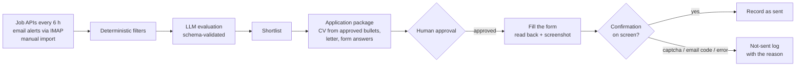

# Job-search operator & application assistant

A personal system that finds remote roles, scores them, prepares a tailored application and fills the forms, **without ever sending anything I haven't approved**.

It has two parts:

- **Operator**: a Node.js service that collects job posts, filters and scores them with an LLM, and builds an application package from evidence I have reviewed.
- **Application assistant**: Python + Playwright scripts, orchestrated with Claude Code, that fill application forms on the companies' own job boards, read every field back and record the result.

## How it works

## Guardrails

- **Evidence before claims.** A metric can only appear in a CV after its evidence is marked as reviewed. Generated summaries cannot add numbers, seniority or language levels on their own.
- **Every model output is validated** against a schema, with retries and backoff, caching, a monthly budget cap and a dead-letter queue that is visible in the UI.
- **Sensitive questions always go to a person.**
- **Approval is explicit and frozen.** Approving means confirming the role, CV, answers, salary and sending method, and it saves an immutable snapshot with a content hash.
- **No scraping of authenticated sites and no automated "Easy Apply".** LinkedIn and Indeed only come in through email alerts.
- **A form counts as sent only if the confirmation appears on screen.** Captchas and email codes are done by a person in a visible browser. The assistant prepares everything, and a person makes the final click.

## Results

- One search run (October 2026): 1,479 posts collected from 8 job boards, 541 passed the filters and 355 were scored against a fixed rubric.
- 15 applications sent in one day across 5 platforms (Ashby, Greenhouse, BambooHR, Recruit CRM and Get on Board), each with a CV variant for the role.

## Lessons from running it

- **False positives.** The first batch recorded 5 applications as sent when the page actually asked for a captcha or an email code. Now the result is read back from the page before anything is recorded.
- **Email codes are tied to a page.** The assistant now keeps that page open and waits for the code.
- **Bot checks.** One automated submission was flagged as spam, so those forms now get a human final step.

## Stack

Node.js · SQLite with migrations · Docker Compose · zod · LLM via OpenRouter (GLM) · IMAP · Python · Playwright · Claude Code · SSH and Tailscale

---

The source code is private because it runs my real job search. I'm happy to walk through the code and the running system on a call.
